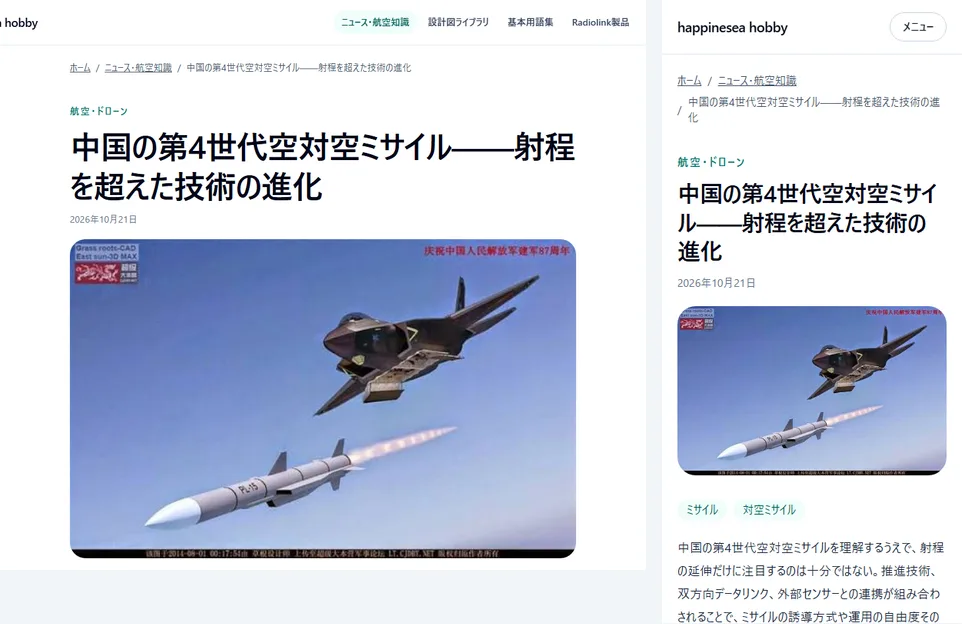

# Pages CMSの記事テンプレートレビュー

基準コミットは `14f22c6`。ローカルで下書きの冒頭、本文、ページ末尾、最終ページ、画像、関連情報・編集クレジットを確認した。画面幅は1440×900、390×844、360×800。下書きのキャプチャはローカルレビュー資材とし、次の比較には公開済みCMS記事を使用した。各図は左がPC、右がスマートフォンの冒頭。

| 変更前                                            | 変更後                                           |
| ------------------------------------------------- | ------------------------------------------------ |
|  |  |

## 監査と採用した変更

| 優先度 | 変更前の根拠                                                                                                    | 共通テンプレートの変更                                                                                               |
| ------ | --------------------------------------------------------------------------------------------------------------- | -------------------------------------------------------------------------------------------------------------------- |
| P0     | 3幅でページ全体の横はみ出しや閲覧不能は観測されなかった。                                                       | 改ページのURL・履歴処理を維持。                                                                                      |
| P1     | 代表記事の `article h1` が2個。公開例ではdescriptionが冒頭段落と重なり、390pxの本文開始がページ先頭から1283px。 | 同じタイトルの先頭H1と重複リードだけをCMS表示で省略。固有のリードは日付直後に配置。公開例の同条件で本文開始は697px。 |
| P1     | デスクトップの本文幅が832px。本文見出しはブラウザー既定のスタイルに近く、画像とキャプションのまとまりが弱い。   | CMS本文を768pxにし、見出し、引用、画像、figure/figcaptionを明示的に整える。                                          |
| P1     | 改ページの数字リンクは幅約30px。共有欄と空の関連情報枠が本文構成を分断していた。                                | 操作対象を最小44pxに拡大。共有を記事末尾へ移し、空の関連情報枠を省略。実在する関連商品は表示する。                   |
| P2     | CMSと既存記事が同じヒーロー設定を使用し、代表記事では長いタイトルの下に本文まで複数の区切りがあった。           | CMSだけに文字サイズの上限と詰めた余白を適用。本文と画像を既存の配色のまま整えた。                                    |

CMS専用のスタイルと表示条件を採用した。サイト全体に記事用CSSを加える案はWordPressやマニュアルへ波及するため採用しなかった。

## 外部Skillの確認と判断

- `elayadesign/ai-design-skills` の確認時点では `landing-page-design` と `figma-designer` を公開している。既存Astroテンプレートの回帰確認と下書き境界はサイト固有なので、リポジトリ内に小さなSkillを用意した。 [公式ツリー](https://github.com/elayadesign/ai-design-skills/tree/456d9e0d3e2d84c748bb143c6ca3d90c45e16213/skills)
- `cathrynlavery/diagram-design` はMIT。公式READMEは `npx skills add cathrynlavery/diagram-design` とCodex Marketplace経由の導入を案内する。PNG書き出しはPythonのPlaywrightとChromiumを使い、SVG書き出しは既定でGoogle Fonts参照を埋め込む。READMEの `--system-fonts` と `self_check.py --offline` はそれぞれ外部フォント参照の回避と検査に使える。 [公式README](https://github.com/cathrynlavery/diagram-design/blob/d7b0176d7e60c6f2ff54067991491ac7622c81fb/README.md) · [ライセンス](https://github.com/cathrynlavery/diagram-design/blob/d7b0176d7e60c6f2ff54067991491ac7622c81fb/LICENSE) · [配布スクリプト](https://github.com/cathrynlavery/diagram-design/tree/d7b0176d7e60c6f2ff54067991491ac7622c81fb/skills/diagram-design/scripts)
- 今回は既存Playwrightとsharpで書き出せるため導入を見送った。将来採用する場合は、動くブランチ名ではなく監査した完全なコミットSHAを固定し、実行するファイルと依存を再確認する。書き出しは外部通信を遮断した環境で行う。配布コードの実行とインストールは今回行っていない。

図解の入力、根拠、原本、PNG/WebP、ALT、採用判断は [technical illustration Skill](../.agents/skills/happinesea-technical-illustration/SKILL.md) に定義した。試作は別途ローカルレビューに置き、記事本文および公開画像ディレクトリへは追加していない。
