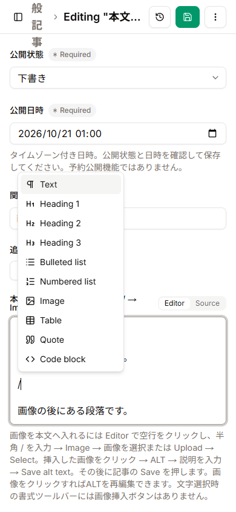
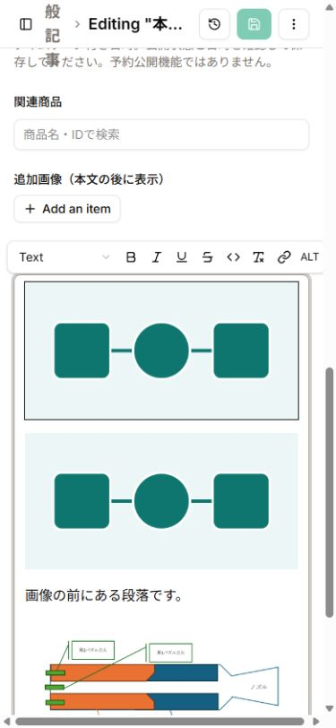

# 本文へ画像を入れる（Pages CMS）

**文字を選択して出る書式ツールバーには、画像挿入ボタンはありません。** 本文の`Editor`で空の段落に半角の`/`を入力し、表示されるメニューの**Image**を選びます。

## 画像を挿入する

1. 「一般記事」で編集対象を開き、本文右上の**Editor**を選ぶ。
2. 画像を置きたい位置の段落末尾でEnterを押して、文字のない段落を作る。その空段落にカーソルを置く。箇条書きの中なら、空の項目でもう一度Enterを押してリストの外へ出る。
3. IMEを半角英数に切り替え、半角の **`/`** を1文字入力する。全角の`／`ではない。
4. メニューの **Image**（画像アイコン）をクリック／タップする。

5. **Select images**が開く。既存画像なら画像のチェックボックスを選択。新しい画像なら**Upload**からファイルを選ぶ。選択状態を確認して、ダイアログ下の**Select**を押す。
6. 元のカーソル位置に画像が入る。文字の選択を解除した場所に入るのではなく、Imageメニューを開いた段落に入る。

## ALTを入力・再編集する

1. 本文中の**画像そのもの**をクリック／タップする。
2. 画像選択時の小さいツールバーにある **ALT** を押す。文字だけを選択している場合は出ない。
3. **Describe image**欄に画像の説明を入力する。
4. 入力欄右の**チェックマーク（Save alt text）**を押す。これだけでは記事全体の保存は終わらない。
5. 画面上部の**Save**も押す。保存成功後に記事を開き直す。
6. 再編集も同じ手順。画像→ALTで現在の説明を開き、変更してチェックマーク→記事のSave。

本文画像のALTはMarkdownの``として保存される。代表画像の「画像の説明」や追加画像の説明とは別の値。公開buildではALTのない本文画像を拒否するため、公開前にすべて入力する。

## メニューが見つからないとき

- **SourceではなくEditorか**を確認する。
- 文字列や画像を選択したままにせず、**空段落をクリック**してから半角`/`を入力する。
- メニューが閉じた場合は、その段落の`/`を消して再入力する。
- 長文では本文下の説明を見落としやすいため、本文のラベル自体にも「画像挿入：空行で半角 / → Image」を表示する。
- 縦長のmobile画面では本文位置までスクロールする。メニューやALTの入力欄はキーボードで隠れる場合があるため、必要に応じてキーボードを閉じる。今回のmobile検証は390×844のviewportで、実機ソフトキーボードは未検証。

## 標準CMSの機能と制約

`.pages.yml`の本文は`rich-text`／`format: markdown`／`media: article_images`／`switcher: true`。mediaは`public/images/articles`へ保存し、記事では`/images/articles`を使う。今回この対応やrender／sanitize処理は変更しない。

| 方法                                    | 保存互換性・保守                                                             | 今回の扱い                                              |
| --------------------------------------- | ---------------------------------------------------------------------------- | ------------------------------------------------------- |
| 標準のslash Image＋本文ラベルの案内     | Markdown・画像path・既存保存を維持できる                                     | 採用。実GUIで選択・挿入・ALT・再編集を検証              |
| Sourceへ画像Markdownを入力              | 同じ保存形式だが、GUI挿入の代わりの手作業になる                              | 補助用。これだけを画像挿入UIの完了根拠にはしない        |
| 追加画像gallery                         | 説明付き画像を扱えるが、表示位置は本文後                                     | 本文の任意位置への挿入の代わりにはしない                |
| hosted Pages CMSへの常設画像ボタン追加  | 公式rich-text設定にtoolbar拡張項目がなく、repoからエディタ本体を変更できない | 追加しない。提供元の対応、または別途self-host改修が必要 |
| Pages CMS本体をself-hostしてtoolbar改修 | 認証・GitHub App・アップデート・エディタ互換性の運用が増える                 | 今回の限定修正では実装しない。必要なら別途設計・承認    |

根拠: [公式rich-text設定](https://pagescms.org/docs/configuration/fields/rich-text/)、[公式エディタ実装](https://github.com/hunvreus/pagescms/blob/main/components/ui/editor/index.tsx)、[slashメニュー](https://github.com/hunvreus/pagescms/blob/main/components/ui/editor/slash-command/commands.ts)。公式設定の確認に加え、hosted画面でImageメニューとALT欄を実際に確認した。

## 今回の検証状況

- 専用下書きで実施。ownerの元記事を直接編集しない。
- desktop: 空段落の半角`/`からImageを開き、既存画像の選択・挿入、ALT指定・再編集・保存・再表示を確認。
- mobile: 実レイアウト幅390pxを確認してから、空段落のImage・既存画像の選択・段落間への挿入・ALT指定／再編集・保存を確認。保存Markdownでも「前の段落→画像→後の段落」の順序を確認。
- アップロードは当初Chrome拡張のファイルURLアクセス許可が無効で自動ファイル選択を拒否された。ownerの承認・手動による一時ON後、desktopとmobile390pxの双方で本文のImage→Upload→Selectを実行し、ALTを設定して保存・再表示・再編集まで確認した。これは検証ツール側の制限であり、通常のowner手動Uploadにこの拡張許可を要求するものではない。検証後は一時許可をOFFに戻す。
- 本文画像UIの発見性は、本文直上の入口表示と本手順で改善する。常設の画像挿入ボタンを追加したわけではなく、ownerによる分かりやすさの最終確認は残る。
- ローカル検証: unit188件PASS、GUI保存データの一時production buildとbuild-output37件PASS、公開表示のdesktop1440/mobile390の2/2 PASS。画像の前後段落・ALT・path・decode・canonical・noindex・overflowを照合した。一時公開時sitemapは225→226。
- 原稿の保存形式・画像path・sanitize／rendererの実装は前回headから変更していない。ownerの元記事・既存3画像・タグにも今回の差分はない。
- 独立レビュー: 未解消P0/P1/P2なし。アップロードの追加検証結果も文書へ反映した。ownerによる発見性の最終確認は別に必要。

- Uploadに使った自作WebPは3,850 bytes。desktop/mobileでGit保存された2ファイルのSHA-256が元ファイルと一致した（`1d27db5be67a4e18b6106031e4181959701a9077c69992c680f44e180a7808f4`）。元の画像や元記事には変更なし。確認用下書き・アップロード画像は検証後に削除する。
- 追加のアップロード検証: desktop/mobileのImage→Uploadで保存した2画像を本文に挿入し、mobileでALTを再編集。保存・再表示後の3画像の順序／ALT／pathと公開表示の2/2ケースを再確認し、build-output37件もPASSした。確認用下書きと2画像は削除済み。
